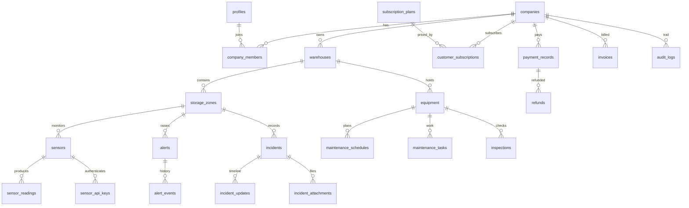

# ColdChain OS — Stage 0: Architecture, Data Model, Roadmap, Costs

Status: **approved 2026-11-24** · Owner: LexConv · Last updated: 2026-11-24

> Stage 1 implementation notes, including the few places the build refines this document, are in [stages/stage-1.md](stages/stage-1.md).

---

## 1. Decisions already locked

| Item | Decision |
|---|---|
| Product | Multi-tenant cold-chain monitoring & operations SaaS, EU-first |
| Stack | Next.js (App Router, TypeScript) · Tailwind CSS · Supabase (Postgres, Auth, Storage) · Razorpay · Vercel · GitHub |
| Repo | `s44-star/coldchain-app` (public during build, private after) |
| Hosting | Vercel project `coldchain-app-z971` → later `coldchain.lexconv.com` |
| Database region | Supabase, Europe |
| Billing currency | USD (Razorpay settles in INR) |
| Language | English only in v1 |
| Super admin | spraharaj68@gmail.com |
| Public contact | ceo@lexconv.com |
| Design | "Glacier" — premium dark landing page, light-first app with dark mode |

---

## 2. System architecture

```
Browser (customer / super admin)
   │  HTTPS
   ▼
Vercel ── Next.js app
   ├── Public pages (landing, pricing, legal)       → static / ISR
   ├── Customer app  /app/*                          → server components, RLS-scoped Supabase client (user JWT)
   ├── Super admin   /admin/*                        → server-only checks + platform_admins table
   ├── API routes    /api/*
   │     ├── /api/payments/*        order create, signature verify      (server only, Razorpay secret)
   │     ├── /api/webhooks/razorpay HMAC verify → idempotent event store → process
   │     ├── /api/ingest/v1/*       sensor readings + heartbeat (device API keys)
   │     ├── /api/reports/*         CSV export, print-ready report pages
   │     └── /api/cron/*            alert sweeps, maintenance reminders (CRON_SECRET)
   └── lib/
         ├── auth/        session, role guards
         ├── payments/    PaymentProvider interface → RazorpayProvider (PayPal etc. later)
         ├── ingestion/   transport-agnostic reading pipeline (HTTP now, MQTT bridge later)
         ├── alerts/      threshold engine
         └── notify/      outbox → email/SMS providers (only when configured)
   │
   ▼
Supabase (EU)
   ├── Postgres  — all tables, RLS on every tenant table, audit triggers
   ├── Auth      — email + password, email verification, password reset
   └── Storage   — private bucket `incident-attachments` (path: company_id/incident_id/file)
```

**Key rules**

- Browser code only ever holds the Supabase **anon/publishable** key and the Razorpay **Key ID**. Service-role key, Razorpay secret and webhook secret stay in Vercel server env vars only.
- Every customer request runs with the user's own JWT, so **Postgres RLS is the final wall** between tenants. Server-side role checks sit in front of it as a second wall.
- The service-role client is used in exactly three places: webhooks, sensor ingestion, cron jobs. Each of these authenticates its caller first (HMAC signature, device key, cron secret).

---

## 3. Multi-tenancy & roles

### Tenancy model
- `companies` is the tenant. Every tenant-owned table carries `company_id NOT NULL`.
- Child tables also carry `company_id`, enforced by **composite foreign keys** (e.g. `storage_zones(warehouse_id, company_id) → warehouses(id, company_id)`), so a zone can never point at another company's warehouse even through a bug.
- RLS helper functions (`SECURITY DEFINER`, `STABLE`):
  - `is_company_member(company_id)`
  - `has_company_role(company_id, roles[])`
  - `is_platform_admin()`

### Roles

Super Admin is a **platform** role (table `platform_admins`), not a company role. It cannot be granted from inside the app; the first one is created with one SQL line after signup.

| Capability | Owner | Admin | Wh. Manager | Operator | Viewer |
|---|:-:|:-:|:-:|:-:|:-:|
| View dashboard, monitoring, reports | ✓ | ✓ | ✓ | ✓ | ✓ |
| Acknowledge / resolve alerts | ✓ | ✓ | ✓ | ✓ | — |
| Create / update incidents | ✓ | ✓ | ✓ | ✓ | — |
| Complete maintenance tasks | ✓ | ✓ | ✓ | ✓ | — |
| Manage zones, equipment, sensors, thresholds | ✓ | ✓ | ✓ (own warehouses) | — | — |
| Create / archive warehouses | ✓ | ✓ | — | — | — |
| Invite users, change roles | ✓ | ✓ (not Owner) | — | — | — |
| Billing & subscription | ✓ | — | — | — | — |
| Transfer ownership, delete company | ✓ | — | — | — | — |

Warehouse Managers can be scoped to specific warehouses (`warehouse_assignments`).

---

## 4. Database design

### Tables

**Identity & tenancy**
- `profiles` — 1:1 with auth.users (name, phone, locale, timezone)
- `companies` — name, country, VAT/registration no., status (`trial` · `active` · `past_due` · `suspended` · `cancelled`), `is_demo`
- `company_members` — user ↔ company, role
- `company_invitations` — email, role, hashed token, expiry, accepted_at
- `warehouse_assignments` — manager ↔ warehouse scoping
- `platform_admins` — super-admin user ids

**Operations**
- `warehouses` — name, address, country, IANA time zone, type, contact, operational status, archived_at
- `storage_zones` — warehouse, name, type (`room` · `refrigerated` · `freezer` · `zone`), min/max temp, min/max humidity, monitoring frequency (minutes), responsible manager, archived_at
- `equipment` — warehouse/zone, type, make/model, serial, install date, status
- `sensors` — warehouse, zone, external device id, type, metadata JSON, status (`registered` · `active` · `offline` · `retired`), last_seen_at
- `sensor_api_keys` — sensor, key prefix, **SHA-256 hash** (never the raw key), revoked_at
- `sensor_readings` — sensor, zone, warehouse, company, recorded_at, received_at, temperature_c, humidity_pct, source (`device` · `manual` · `simulated`), quality (`ok` · `suspect` · `invalid`). **Unique (sensor_id, recorded_at)** for duplicate protection.

**Alerts, incidents, maintenance**
- `alerts` — type, severity, status (`open` · `acknowledged` · `resolved`), triggering reading, value vs. threshold, assigned_to, acknowledged_by/at, resolution notes, resolved_at
- `alert_events` — full alert history (created, acknowledged, assigned, resolved, reopened)
- `incidents` — warehouse, zone, title, description, status (`open` · `under_investigation` · `action_required` · `resolved` · `closed`), assigned_to, corrective action, resolution, linked alert
- `incident_updates` — timeline entries
- `incident_attachments` — storage path, mime, size, uploaded_by
- `maintenance_schedules` — equipment, recurrence (every N days), next_due_at
- `maintenance_tasks` — equipment, schedule (optional), assigned_to, due_at, status, notes, completed_at
- `inspections` — equipment/zone, inspector, result (`pass` · `fail` · `needs_attention`), findings

**Reporting, audit, notifications**
- `reports` — type, filters, date range, time zone, generated_by, row count (record of every export)
- `audit_logs` — company, actor, action, resource type/id, metadata JSON, ip, created_at. **Insert-only**: no UPDATE/DELETE policy and privileges revoked.
- `notifications` — in-app notifications per user
- `notification_deliveries` — outbox per channel (`email` · `sms`), status `pending` · `sent` · `failed` · `provider_not_configured`

**Billing**
- `subscription_plans` — code (`starter` · `professional` · `enterprise`), name, monthly price, annual price, setup fee, currency, limits (warehouses, zones, sensors, users), features JSON, Razorpay plan ids, is_active. **Prices live only here, editable from super admin.**
- `customer_subscriptions` — company, plan, interval, provider subscription id, status, current period start/end, cancel_at_period_end
- `payment_records` — company, provider order/payment id, amount, currency, purpose (`setup_fee` · `subscription`), status, failure reason
- `refunds` — payment, amount, reason, provider refund id, status
- `invoices` — number, company, line items, totals, currency, status, issued_at
- `payment_webhook_events` — provider event id (**unique**), type, raw payload, signature_valid, processed_at, error

**Platform**
- `app_settings` — key/value (trial length, international-payments-enabled flag, maintenance mode)
- `rate_limits` — fixed-window counters (free, works across serverless instances)

### Relationships



### Conventions
- UUID primary keys (`gen_random_uuid()`), `created_at` / `updated_at` with a shared trigger.
- All timestamps `timestamptz` stored in UTC; warehouse time zone used for display and reports.
- Temperatures in °C, humidity in %RH; CHECK constraints for sane ranges (−90 to +60 °C, 0–100 %).
- Indexes on every foreign key, plus `(sensor_id, recorded_at DESC)`, `(company_id, status)` on alerts/incidents, BRIN on `sensor_readings.recorded_at`.
- Soft delete (`archived_at`) for warehouses, zones, equipment, sensors — readings and history are never orphaned.
- Migrations as numbered SQL files in `supabase/migrations/`, run in order in the Supabase SQL Editor.

---

## 5. Monitoring engine & future sensors

- **Ingestion API** `POST /api/ingest/v1/readings` — header `Authorization: Bearer <device key>`; batch up to 500 readings; Zod validation; device→sensor→zone→company resolved server-side (the device cannot claim another company's zone); duplicates ignored via the unique key; out-of-range values stored with quality `invalid`, not dropped.
- **Heartbeat** `POST /api/ingest/v1/heartbeat` — updates `last_seen_at`, firmware, battery, signal.
- **Rate limit** per device key and per IP.
- **Timestamps** — device time accepted within a tolerance window; future timestamps rejected; `received_at` always recorded.
- **MQTT later** — a broker bridge calls the same `lib/ingestion` pipeline; no app changes.
- **Honesty** — until a real device sends data, the UI shows "No live hardware connected". Demo companies show a permanent **SIMULATED DATA** badge, and simulated readings are tagged `source = simulated` in the database.

### Alert engine
- **On ingest:** reading vs. zone thresholds → temp/humidity high/low alerts (no duplicates while one is open for the same zone and type).
- **Cron sweep (every 10 min):** missing readings (no data for 2× the monitoring frequency), sensor disconnected (heartbeat stale), maintenance due or overdue.
- Severity defaults are configurable per company: e.g. excursion > 2 °C beyond limit = Critical.
- Notifications are written to the outbox; email/SMS are sent **only** if a provider key is configured, otherwise marked `provider_not_configured` and shown as such in the UI.

---

## 6. Payments (Razorpay)

- `PaymentProvider` interface (`createOrder`, `verifyPayment`, `createSubscription`, `cancelSubscription`, `refund`, `verifyWebhook`) → `RazorpayProvider`. PayPal or Stripe later means one new class.
- **Setup fee:** server creates an Order → Checkout → server verifies `razorpay_signature` (HMAC-SHA256) → status set only after verification **and** webhook confirmation.
- **Subscriptions:** Razorpay Subscriptions API. When the super admin changes a price, a new Razorpay plan is created (Razorpay plans are immutable) and existing subscribers stay on the old one until renewal or upgrade.
- **Webhook:** raw-body HMAC check with the webhook secret → insert into `payment_webhook_events` keyed by event id (a duplicate means it was already processed, so 200 is returned and nothing changes) → update subscription/payment → audit log.
- **International gate:** if international payments aren't enabled, checkout shows "Payments pending activation — contact ceo@lexconv.com" instead of a broken button.
- No card data is ever stored; Razorpay Checkout handles it.
- Invoice records are generated per successful payment. *Tax wording on invoices (GST/VAT) must be confirmed with your CA before live billing.*

---

## 7. Security checklist (built in, verified in Stage 6)

RLS on every table · server-side role guards · Zod validation on every input · CSRF-safe server actions · file uploads checked for type (magic bytes), size (10 MB) and extension, stored in a private bucket, served via short-lived signed URLs · HMAC on payments and webhooks · hashed device keys · DB-backed rate limiting on auth, ingest and payment routes · security headers (CSP, HSTS, frame-deny) · insert-only audit trail · no secrets in the repo (`.env.example` only) · generic error messages to clients, details in server logs.

---

## 8. Folder structure

```
coldchain-app/
├── docs/                      ARCHITECTURE.md, SETUP.md, per-stage notes
├── supabase/
│   ├── migrations/            0001_extensions.sql … 00NN_*.sql
│   └── seed/                  plans.sql, demo_company.sql (demo only)
├── src/
│   ├── app/
│   │   ├── (public)/          landing, features, pricing, contact, terms, privacy
│   │   ├── (auth)/            login, register, verify, forgot, reset, invite/[token]
│   │   ├── app/               dashboard, warehouses, zones, monitoring, alerts,
│   │   │                      incidents, maintenance, reports, team, billing, settings
│   │   ├── admin/             dashboard, companies, users, plans, payments,
│   │   │                      subscriptions, logs, settings
│   │   └── api/               payments, webhooks, ingest, reports, cron
│   ├── components/            ui/ (design system), charts/, layout/, forms/
│   ├── lib/                   supabase/, auth/, payments/, ingestion/, alerts/,
│   │                          notify/, reports/, validation/, rate-limit/, audit/
│   └── types/                 generated database types
├── tests/                     unit (vitest) + e2e (playwright)
├── .env.example
└── README.md
```

---

## 9. Roadmap

Every stage ends with: files list · SQL to run · what you configure · what's unfinished · test results.

| Stage | Scope | What you do afterwards |
|---|---|---|
| **1** | Next.js setup, design system, full schema + RLS migrations, `.env.example` | Run SQL files in Supabase, add env vars in Vercel |
| **2** | Auth (register, verify, login, reset), company onboarding, invitations, roles, super-admin bootstrap | Run 1 SQL line to make yourself super admin; set Supabase auth redirect URLs |
| **3** | Warehouses, zones, equipment, sensors + keys, ingestion API, dashboard, monitoring charts | Register a test sensor, send a test reading |
| **4** | Alerts engine, incidents (with photo upload), maintenance, inspections, reports (CSV + print-to-PDF), audit log views | — |
| **5** | Razorpay: plans, setup fee, subscriptions, webhooks, billing page, invoices, refunds | Create webhook in Razorpay Test Mode |
| **6** | Super admin panel, security review, tests, production checklist, custom domain | DNS record for `coldchain.lexconv.com`, upgrade plans before first customer |

**Build-environment note:** package installs are blocked in the current build session, so code is compiled and checked by Vercel on every push. Unit/e2e tests will run once installs are available, either in a session with network access or in a GitHub Actions workflow (free for public repos, with free minutes on private ones). No stage will be called "production ready" until those tests pass.

---

## 10. Infrastructure costs (monthly, USD)

| Service | Development (now) | First paying customer | Notes |
|---|---|---|---|
| Vercel | $0 (Hobby) | **$20** (Pro, 1 member) | Hobby is non-commercial only, so upgrade before charging anyone |
| Supabase | $0 (Free) | **$25** (Pro) | Pro includes $10 compute credit = 1 Micro project; daily backups, no auto-pause |
| Resend (email) | $0 | $0 → $20 | Free: 3,000/mo, 100/day; Pro $20 for 50k |
| Domain | already owned | — | lexconv.com |
| Razorpay | $0 | per transaction | International cards up to ~3%; no monthly fee |
| SMS | — | optional later | Not built until a provider is chosen |
| **Total fixed** | **$0** | **≈ $45–65 / month** | |

**Scaling outlook:** at ~20–50 customers with real sensors sending every 5 min, the main cost growth is Supabase compute and disk (next compute size up, plus storage for readings). Expect roughly $60–150/month. Older readings can be rolled into hourly aggregates to keep the database small.

---

## 11. Open points (defaults apply if not changed)

1. **Free trial:** 14 days, configurable in super admin. *(default: yes)*
2. **PDF reports:** print-optimised report pages saved as PDF from the browser, so there's no paid PDF service. *(default: yes)*
3. **Super-admin bootstrap:** one SQL line after you sign up, instead of an env var. *(default: yes; the `SUPER_ADMIN_EMAIL` env var is no longer needed)*
4. **Data retention:** raw readings kept for 24 months, then aggregated. *(default: yes)*
